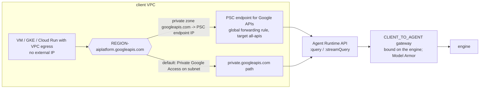

# Policy Studio: private networking (plan)

**Status:** plan only, nothing built. **Scope narrowed 2026-10-15** (user decision): Policy Studio *detects* private networking. It doesn't build it.

The original, much larger plan (create attachments, DNS zones, PSC endpoints and connectivity templates; migrate gateways; detect private destinations) is kept below as **Appendix A** for reference. It is superseded. Live-test results are in [P0_FINDINGS.md](P0_FINDINGS.md). A step-by-step console guide for building private egress by hand exists as a separate PDF.

Placeholders: project `acme-prod` (number `123456789012`), VPC `corp-vpc`, region `us-east4`.

---

## 1. Goal

Policy Studio is about **who can call what**. Private networking matters to that question in two places only, and both are explicit settings Google exposes, so nothing is guessed:

1. **Agent Runtime agents with their own private networking** (Agent Runtime PSC interface, `pscInterfaceConfig`).
   - An agent like this reaches a VPC **without going through the gateway**, so no registry check, no IAP grant and no gateway logs apply to those calls.
   - Its grants in Policy Studio are therefore meaningless for its VPC traffic.
2. **Egress gateways with private networking** (`agentConnectivityTemplate`, or the older inline `networkConfig`). The gateway can reach into a VPC; Policy Studio shows which VPC, which private domains it can resolve, and the egress mode.

**Out of scope:**
- creating or deleting network attachments, PSC endpoints, DNS zones or connectivity templates;
- gateway migration (in place or blue/green);
- private ingress;
- **per-destination private/public detection**: too many variables, including DNS zones in other projects, forwarding to on-prem, and Cloud Run ingress settings.

Policy Studio may *show* the gcloud or Terraform for the network pieces as guidance, but never applies them.

## 2. What is read

| Resource | Field(s) | API |
|---|---|---|
| Agent Runtime agent | `spec.deploymentSpec.pscInterfaceConfig.networkAttachment`, `pscInterfaceConfig.dnsPeeringConfigs[]` (domain, targetProject, targetNetwork), plus the existing `agentGatewayConfig` and `identityType` | `GET aiplatform v1 .../reasoningEngines` (already listed by Inventory) |
| Agent Gateway | `agentConnectivityTemplate` (project **number** form), `networkConfig.egress.networkAttachment`, `networkConfig.dnsPeeringConfig` | `GET networkservices v1 .../agentGateways` (already listed) |
| Agent connectivity template | `egressNetworkConfig.networkAttachment`, `.dnsPeeringConfig.domains[]`, `.targetNetwork`, `.vpcEgress`, `.tlsConfig` (presence only), `accessPath` | `GET networkservices v1 .../agentConnectivityTemplates/{name}` (new read) |
| Network attachment (optional, for the label) | `subnetworks[0]` → VPC name, `connectionPreference`, `connectionEndpoints[]` count | `GET compute v1 .../networkAttachments/{name}` (new read; the field is enough if this is denied) |

New permissions to check in `/auth` (read only):
- `networkservices.agentConnectivityTemplates.get` / `list`;
- `compute.networkAttachments.get` (optional).

A missing permission degrades to "private networking: can't read details", never an error.

## 3. Model (API.md additions)

```ts
Engine += { psc_interface: null | { network_attachment: string, vpc?: string, dns_domains: string[] } }
Gateway += { private_egress: null | {
  source: "template" | "inline",
  template?: string,              // full name
  network_attachment: string,
  vpc?: string,                   // from the attachment's subnet, when readable
  dns_domains: string[],          // e.g. ["run.app.", "corp.internal."]
  vpc_egress?: "PRIVATE_RANGES_ONLY" | "ALL_TRAFFIC",
  custom_trust?: boolean,         // tlsConfig present
  error?: string } }              // couldn't read the template / attachment
```

## 4. Audit findings

| Id | Finding | Severity | Fix offered |
|---|---|---|---|
| N1 | Agent has its own private networking (PSC interface) and **no** egress gateway: its VPC calls bypass all checks | high | Redeploy guidance (no PSC interface, Agent Identity, bound to the gateway) |
| N2 | Agent has a PSC interface **and** a gateway binding: broken (P0: no Google API access) | high | Redeploy guidance |
| N3 | Gateway uses inline `networkConfig` instead of a connectivity template (older form; VPC-SC and custom trust need a template) | info | Guidance (two-step update, from P0) |
| N4 | Gateway references a template Policy Studio can't read | medium | Permission hint |
| N5 | Template egress mode `ALL_TRAFFIC` (all agent traffic goes into the VPC; needs NAT; used for VPC-SC) | info | None (awareness) |

## 5. Preflight

Block `bind_gateway` for an engine with `psc_interface`. Message: "This agent has its own private networking (PSC interface). Google rejects or breaks agents with both; redeploy it without the PSC interface." This extends the existing `bindable=false` handling.

## 6. UI

- **Gateways step:** a "Private egress" row on the gateway card. It shows the VPC, the domains as chips, the egress mode, and template vs inline. When the gateway has none, the row reads "Public egress only".
- **Policy map:** a small "Private egress · corp-vpc" chip on the gateway node, with the tooltip listing the domains. On agent nodes with a PSC interface, a red "Own VPC access (bypasses gateway)" chip.
- **Inventory:** a "Private networking" column on engines.
- **Audit:** N1–N5.
- **Learn panel / glossary:** short entries for "PSC interface", "connectivity template" and "private egress", reusing the plain-English explanations.
- **Mock world:**
  - one gateway with a template (domains `run.app.`, `corp.internal.`);
  - one with inline `networkConfig`;
  - one agent with a PSC interface and no gateway;
  - one with both.

## 7. Registry entries for private destinations (kept from the earlier decision)

The user decided Policy Studio should create Agent Registry entries. That applies to any destination, private or not.

- **New intent:** `registry_service`, with create/delete, read-back and undo. Body:
  - `displayName`;
  - `interfaces[{url, protocolBinding}]`, with several URLs per entry (e.g. both `run.app` forms);
  - `endpointSpec` or `mcpServerSpec`.
- **Writer allowlist:** `agentregistry v1 .../services` POST and DELETE.
- **Where it shows:** Builder "Add a destination" and Inventory "Register…". Every Apply flow has a preview.

## 8. Optional later

"Seen in traffic" label for destinations: when gateway logs show a private upstream `httpRequest.serverIp` (10/8, 172.16/12, 192.168/16) for a destination, mark it "private (seen in traffic)". This is the only per-destination signal that's 100% reliable, and it's cheap because `/gateway-logs` is already read.

## 9. Reuse with the demo

The scope is small, so there's no shared package for now. The parsing lives in one dependency-free module, `backend/policy_studio/gcp/networking.py` (pure functions: engine/gateway/template JSON → the §3 model, plus the N1–N5 rules), which the demo can copy or import later. For a "private egress" story, the demo gets its own bootstrap sample (built by hand or from the PDF guide), and Policy Studio then discovers it.

## 10. Phases

| Phase | Content | Size |
|---|---|---|
| N-1 | Discovery (§2–§3), `/auth` permissions, mock world, API.md | S (1–1.5 d) |
| N-2 | Audit N1–N5, preflight block, UI (Gateways, map, Inventory, Learn) and tests | S–M (1.5–2 d) |
| N-3 | `registry_service` intent (create/delete, render, preview, undo) | M (2 d) |
| N-4 (optional) | "Seen in traffic" destination label | S (0.5 d) |

N-1 plus N-2 is the 3–4 days discussed. N-3 is the separate registry write path.

---

# Appendix A: original detailed plan (superseded 2026-10-15)

Kept for reference: the research, verified facts (§2 there), resource inventory, create/delete flows and the P0-driven decisions. Phases P1–P8 are **not** planned.

## 1. Goal and scope

Discover, audit, and create or delete (with read-back and undo) every configuration element needed when **clients** or **destinations** of Agent Runtime agents live in a Google Cloud VPC:

- **(a) Ingress.** A client in a VPC (a Compute Engine VM, GKE, or Cloud Run with VPC egress) calls an Agent Runtime agent (`:query` / `:streamQuery`) that is bound to a `CLIENT_TO_AGENT` Agent Gateway.
- **(b) Egress.** An Agent Runtime agent bound to an `AGENT_TO_ANYWHERE` gateway calls an MCP server or API inside a VPC (an internal Application Load Balancer, a VM, GKE, or Cloud Run with internal ingress).

Out of scope for writes (Policy Studio reads and **advises** only): creating VPCs, subnets, firewall rules, routes, Cloud NAT, load balancers, Cloud Run ingress settings and certificates. These are network-team resources with a much larger blast radius than policy. See the per-resource table in [§3](#3-resource-inventory-per-scenario).

### 1.1 What "private" actually means for each direction (the short version)

| | What carries the private path | Is there anything gateway-specific? |
|---|---|---|
| **Egress (b)** | The **gateway's** own PSC interface into your VPC: a network attachment referenced by an **Agent Connectivity Template** (current docs), or by the older inline `networkConfig` (codelabs) | **Yes**: attachment, DNS peering, `vpcEgress`, TLS trust, all on the template |
| **Ingress (a)** | Ordinary private access to Google APIs from the VPC: **Private Google Access** on the client subnet, or a **PSC endpoint for Google APIs** plus a private DNS zone, so `REGION-aiplatform.googleapis.com` resolves to an internal IP | **No.** The docs describe no private ingress option for `CLIENT_TO_AGENT` (no PSC endpoint, no internal mode). The gateway binding lives on the engine, not on the network path |

**Surprise for (a):** making the client private does not change what the ingress gateway does. Whether a call that arrives over PSC-for-Google-APIs is still governed by the bound `CLIENT_TO_AGENT` gateway is **not documented** (expected yes, because binding is server-side on the engine, but unverified). And in our own testing the ingress gateway enforces **Model Armor only**, not caller identity. So "private ingress" is a network-reachability story, not an authorization story.

### 1.2 Diagrams

**(b) Egress to a private MCP server (template model)**

```mermaid
flowchart LR
  subgraph Google-managed
    E[Agent Runtime engine<br/>agentGatewayConfig.agentToAnywhereConfig] --> G[Agent Gateway<br/>AGENT_TO_ANYWHERE<br/>IAP REQUEST_AUTHZ + Model Armor]
    G -.uses.-> T[agentConnectivityTemplate<br/>vpcEgress, dnsPeeringConfig, tlsConfig]
  end
  G -- PSC interface --> NA[network attachment<br/>ACCEPT_AUTOMATIC, subnet >= /28, PGA on]
  subgraph "corp-vpc (acme-prod or my-vpc-project)"
    NA --> SN[attachment subnet]
    SN --> ILB[internal ALB :443<br/>cert: public CA or TrustConfig]
    ILB --> CR[Cloud Run internal / GKE / VM<br/>MCP server]
    Z[(Cloud DNS private zone<br/>corp.example.com.)]
  end
  T -. DNS peering .-> Z
  R[(Agent Registry<br/>mcpServers/... url=https://mcp.corp.example.com/mcp)] -. roles/iap.egressor .- G
```

**(a) Ingress from a VPC client**



---

## 2. Verified facts

Status column: **Doc** = stated in official docs; **API** = present in the REST discovery document; **Live** = seen with read-only calls in a test project; **CL** = codelab only; **Unverified** = inferred or contradicted. None of the Agent Gateway pages carries a Preview label and none states GA; the GA gcloud group `gcloud network-services agent-gateways` exists (alpha/beta variants too). **Launch stage: unverified.**

Sources: [VPC] = [Set up VPC connectivity](https://docs.cloud.google.com/gemini-enterprise-agent-platform/govern/gateways/set-up-vpc-connectivity), [OVR] = [Agent Gateway overview](https://docs.cloud.google.com/gemini-enterprise-agent-platform/govern/gateways/agent-gateway-overview), [SETUP] = [Set up Agent Gateway](https://docs.cloud.google.com/gemini-enterprise-agent-platform/govern/gateways/set-up-agent-gateway), [RT] = [Agent Gateway with Agent Runtime](https://docs.cloud.google.com/gemini-enterprise-agent-platform/scale/runtime/agent-gateway-runtime-deploy), [TS] = [Troubleshoot Agent Gateway](https://docs.cloud.google.com/gemini-enterprise-agent-platform/troubleshooting/troubleshoot-agent-gateway), [PSCI] = [Runtime PSC interface](https://docs.cloud.google.com/gemini-enterprise-agent-platform/scale/runtime/private-service-connect-interface), [LOC] = [Agent locations](https://docs.cloud.google.com/gemini-enterprise-agent-platform/resources/agent-locations), [CL1] = [Agent Gateway codelab](https://codelabs.developers.google.com/cloudnet-agent-gateway), [CL-ARUN] = [Runtime egress to VPC codelab](https://codelabs.developers.google.com/agw-cuj-arun-egress-vpc), [CL-GE] = [GE custom MCP egress codelab](https://codelabs.developers.google.com/agw-ge-custom-mcp-egress-vpc-registry), [CL-VPCSC] = [VPC-SC codelab](https://codelabs.developers.google.com/agw-vpcsc-codelab), [PSCAPI] = [PSC endpoints for Google APIs](https://docs.cloud.google.com/vpc/docs/configure-private-service-connect-apis), [REGEP] = [PSC for regional endpoints](https://docs.cloud.google.com/vpc/docs/about-accessing-regional-google-apis-endpoints), [VXACC] = [Accessing the Agent Platform API](https://docs.cloud.google.com/vertex-ai/docs/general/googleapi-access-methods), [VXPSCI] = [Vertex AI PSC interface setup](https://docs.cloud.google.com/vertex-ai/docs/general/vpc-psc-i-setup), [RUNING] = [Cloud Run ingress](https://docs.cloud.google.com/run/docs/securing/ingress), [CMREG] = [Regional Google-managed cert with DNS authorization](https://docs.cloud.google.com/certificate-manager/docs/deploy-google-managed-regional).

### 2.1 Gateway egress networking

| # | Fact | Source | Status |
|---|---|---|---|
| F1 | **Two config models exist.** (A) current: a separate resource `projects/P/locations/L/agentConnectivityTemplates/T`, referenced by the gateway's top-level `agentConnectivityTemplate` field. (B) older: inline `AgentGateway.networkConfig{egress{networkAttachment}, dnsPeeringConfig{domains[], targetProject, targetNetwork}}`. The VPC page documents only (A); codelabs CL1, CL-ARUN, CL-GE use (B). Both are in REST v1. | [VPC], [CL1], API | Doc + API |
| F2 | Template fields: `accessPath` (Required, **Immutable**: `AGENT_TO_ANYWHERE`/`CLIENT_TO_AGENT`), `deploymentModel` (Required: `CENTRALIZED`/`AMBIENT`), `egressNetworkConfig{networkAttachment, dnsPeeringConfig{domains[], targetNetwork}, vpcEgress, tlsConfig{trustConfig, additionalRoots}}`, plus `agentCompute` (`GKE`/`CLOUD_RUN`/`GCE_VM`) and `accessTypes` (`PUBLIC`/`PRIVATE`). Methods: create (`?agentConnectivityTemplateId=`), get, list, patch (`updateMask`), delete (`etag`). | API, [VPC] | API; `agentCompute`, `accessTypes`, `AMBIENT` **undocumented** |
| F3 | Templates support **egress only** (`AGENT_TO_ANYWHERE`). | [VPC] | Doc |
| F4 | `networkAttachment` is **immutable** once set on a template or gateway. | [VPC] | Doc |
| F5 | A template **can't be modified while a gateway references it**. To change DNS peering, `vpcEgress` or TLS: create a new template on the same attachment and point the gateway at it. To change the attachment or the VPC: a **new template and a new gateway**. | [VPC] | Doc |
| F6 | **A gateway created without a template must be deleted and recreated** to get VPC connectivity. | [VPC] | Doc |
| F7 | Pointing an existing gateway at a different template: the docs say "update the gateway", but the GA gcloud group has no `update` (only import/export/describe/list/delete), and no doc lists the allowed `updateMask` paths. `import` acts as an upsert. CL1 PATCHes `networkConfig.dnsPeeringConfig` onto an existing gateway (v1beta1) because the Terraform beta provider lacks it, which is evidence that an inline-model PATCH worked at the time. | [VPC], [CL1], gcloud reference | **Unverified** for `updateMask=agentConnectivityTemplate` and `networkConfig.egress` |
| F8 | Attachment: `ACCEPT_AUTOMATIC`; subnet **min /28** (12 usable IPs, enough for one gateway; `/26` or `/24` for several); **Private Google Access must be on** the attachment subnet; attachment subnet and DNS `targetNetwork` must be the **same VPC** (validation fails otherwise). `ACCEPT_MANUAL` / producer accept lists exist on network attachments in general but are not mentioned for the gateway. An attachment can't be deleted with open connections; only subnet, accept/reject lists and description are patchable (with `fingerprint`); several PSC interfaces can share one attachment. | [VPC], [network attachments](https://docs.cloud.google.com/vpc/docs/create-manage-network-attachments) | Doc |
| F9 | Attachment region = gateway region: never stated, but the attachment is regional and every example uses the gateway's region. | [VPC], [CL1] | **Unverified** (treat as required) |
| F10 | Attachment project: a service project (recommended for Shared VPC, referencing the host subnet) or the host project. | [VPC] | Doc |
| F11 | Service agent: `service-<GATEWAY_PROJECT_NUMBER>@gcp-sa-agentgateway.iam.gserviceaccount.com`. Attachment in a service project: `roles/compute.networkUser` + `roles/dns.peer` on the **host** project. Attachment in the host project: `roles/compute.networkAdmin` (or custom: `compute.networkAttachments.get/update`, `compute.regionOperations.get`) + `roles/dns.peer`. Provisioning identity on the host: `roles/compute.networkViewer`, `roles/dns.reader`, `roles/networkconnectivity.regionalEndpointAdmin`, `roles/networkconnectivity.consumerNetworkAdmin` (or Viewer/Editor). Attachment creator: `roles/compute.networkUser`. | [VPC] | Doc. CL-VPCSC grants `roles/agentgateway.serviceAgent` to the **aiplatform** service agent instead: inconsistent |
| F12 | The existing gateways we read expose a different identity, `agentGatewayCard.serviceExtensionsServiceAccount` = `service-<N>@gcp-sa-dep.iam.gserviceaccount.com` (used for Model Armor). This is not the `gcp-sa-agentgateway` agent named for networking. | Live | Live; which agent does what is **unverified** |
| F13 | DNS peering: domains end with `.`; each needs a matching private zone authorized for the target network; the zone must be in the project owning `targetNetwork`; one transitive hop (up to 3 VPCs); accepted zone types are authoritative private, forwarding, or peering (**chained peering zones return NXDOMAIN**); **no direct cross-project peering** (validation fails if `targetNetwork` is in another project than the attachment); `targetNetwork` uses the **project ID**, not the number; a root `.` is allowed only as a **forwarding** zone; split-horizon public names resolving to RFC 1918 need no peering. | [VPC] | Doc |
| F14 | In the template, `dnsPeeringConfig` has no `targetProject` (the project is inside `targetNetwork`); the inline model has `targetProject`. The inline `dnsPeeringConfig` is a **single object**, not a list. | API, [VPC] | API |
| F15 | `vpcEgress`: `PRIVATE_RANGES_ONLY` routes RFC 1918, 100.64/10, 240/4, 199.36.153.8/30 and 199.36.153.4/30 (and PSC-for-APIs endpoints via peering) into the VPC; internet traffic leaves "directly through Agent Gateway". `ALL_TRAFFIC` sends everything into the VPC: you need a `0.0.0.0/0` route and **Cloud NAT on the attachment subnet**. Required for VPC-SC. | [VPC] | Doc |
| F16 | Egress source IPs are the attachment subnet's range ("static source IP range"), so firewall rules can name it. No required firewall rules or ports are documented. | [VPC], [CL-GE] | Doc; ports **unverified** |
| F17 | TLS: publicly trusted CAs by default (SAN must match the hostname). **Private CA and self-signed are supported** through a Certificate Manager **TrustConfig** in `tlsConfig.trustConfig` (same project and region as the gateway and template). `additionalRoots`: `PUBLICLY_TRUSTED_ROOTS` (default) or `NO_ADDITIONAL_ROOTS`. Rotation is manual (no Secret Manager). Chain failure means connection failure. | [VPC], [TS], [OVR] | Doc. Contradicted by CL-GE ("publicly trusted CA") and CL1 ("does not currently validate the self-signed fallback cert"): both use the inline model, so **private CA is template-only** |
| F18 | Plain HTTP to private destinations: not stated; every example is HTTPS :443. | — | **Unverified** |
| F19 | Up to **two registries** per gateway (one global + one regional/multi-regional); regional wins. Up to **5,000** registry resources per gateway. | [SETUP], [OVR] | Doc |
| F20 | `selfManaged{resourceUri(s)}` attaches a gateway to an existing ALB or Secure Web Proxy. | API | API; **undocumented**, out of scope |

### 2.2 Registry and authorization of private destinations

| # | Fact | Source | Status |
|---|---|---|---|
| F21 | Destinations are registered by **URL/hostname** (`interfaces[{url, protocolBinding: JSONRPC/GRPC/HTTP_JSON}]` on `services`), never by IP. Private names resolve through DNS peering + a private zone. | API, [CL-GE], [CL1] | Doc/CL |
| F22 | Two documented private-destination patterns: (1) a custom private domain on an **internal ALB** with a regional Google-managed cert (CL1, `mcp.<domain>`); (2) register the public-looking `*.run.app` URL and override `run.app.` in a private zone to a **PSC endpoint for Google APIs** IP (CL-GE, CL-ARUN). | [CL1], [CL-GE], [CL-ARUN] | CL |
| F23 | Hostname matching is **exact**: register every variant (regional, `.mtls.`). | [RT], [TS] | Doc |
| F24 | Reachability is not authorization: egress is default deny; the agent identity needs `iap.resources.egressViaIAP` (in `roles/iap.egressor`) on the registry resource, as for public destinations. VPC connectivity changes nothing about IAP grants. | [OVR], [SETUP], [TS] | Doc |
| F25 | The private-zone suffix `*.internal.` style is discouraged with the gateway (CL1: don't use an unroutable suffix like `mcp-server.internal.` when the gateway and private networking are both on). | [CL1] | CL |

### 2.3 Agent Runtime's own PSC interface (PSC-I)

| # | Fact | Source | Status |
|---|---|---|---|
| F26 | Engine field: `spec.deploymentSpec.pscInterfaceConfig{networkAttachment, dnsPeeringConfigs[{domain, targetProject, targetNetwork}]}` (the Vertex AI service agent needs `dns.peer` on `targetProject`). With PSC-I, `maxInstances` is capped at 100. | API | API; seen Live on one engine |
| F27 | "You can't change an existing Private Service Connect interface for a Runtime agent without recreating the resources." Min `/28`; subnets 100.64.0.0/20 and 240.0.0.0/4 not supported; can't reach some non-RFC 1918 ranges. Shared VPC: aiplatform service agent gets `compute.networkUser` on the host, and `compute.networkAdmin` (or custom) where the attachment lives. | [PSCI] | Doc |
| F28 | **PSC-I plus an egress gateway binding:** no doc says whether both are allowed on one engine or which path wins. [RT] says binding routes "outbound traffic, including platform calls ... through the gateway"; [VPC] gives the gateway its own PSC-I. So the gateway attachment is the intended governed private path; an engine-level PSC-I is a potential **ungoverned** side door. | [RT], [VPC] | **Unverified** (spike P0) |
| F29 | Network attachments expose consumers: `connectionEndpoints[]{projectIdOrNum, ipAddress, status, subnetwork}` (a Google tenant project). That is how Policy Studio can tell an attachment is in use and count used IPs. | Live, API | Live; mapping a tenant project to a specific gateway or engine is **unverified** |
| F30 | Agent Runtime PSC-I traffic to Google APIs is resolved in the producer environment, so **Cloud Run with internal ingress returns 403/404** unless the VPC has a PSC endpoint for Google APIs. Cloud Run "internal" admits an internal ALB, a VPC-SC perimeter, VPC networks in the same project, and the Shared VPC it egresses to; a network attachment isn't listed. | [VXPSCI], [RUNING] | Doc for Vertex PSC-I; **unverified** for the gateway's PSC-I. Front Cloud Run with an internal ALB (pattern 1) or use pattern 2 |

### 2.4 Ingress (client in a VPC)

| # | Fact | Source | Status |
|---|---|---|---|
| F31 | No private ingress option for `CLIENT_TO_AGENT` is documented. The ingress gateway has no registries; it governs only `query` / `streamQuery`; the gateway and agent must be in the same project and region; Agent Runtime only; Gemini Enterprise is egress only. | [SETUP], [RT], [OVR] | Doc |
| F32 | Private client access to `REGION-aiplatform.googleapis.com`: Private Google Access on the client subnet, or a **global** PSC endpoint for Google APIs (address `--purpose=PRIVATE_SERVICE_CONNECT`, forwarding rule `--target-google-apis-bundle=all-apis` or `vpc-sc`). In Shared VPC, deploy the endpoint in the host project. DNS must resolve `REGION-aiplatform.googleapis.com` or `aiplatform.googleapis.com` to the PGA path or the endpoint IP. | [VXACC], [PSCAPI] | Doc |
| F33 | PSC endpoint for Google APIs: the name is 1–20 lowercase letters and digits; it **can't be updated** (delete and recreate); it is **not reachable from peered VPCs**; it auto-creates `p.googleapis.com` names through Service Directory (`SERVICE-ENDPOINT.p.googleapis.com`) usable only by clients with a custom endpoint setting. For unmodified clients, create a private `googleapis.com` zone with an apex A record to the endpoint IP and a `*.googleapis.com` CNAME to the apex. | [PSCAPI] | Doc |
| F34 | That the `*.googleapis.com` wildcard covers `us-east4-aiplatform.googleapis.com` (a single-label subdomain) is our inference. | — | **Unverified** (expected yes) |
| F35 | PSC **regional** endpoints are a different resource (`networkconnectivity v1 .../regionalEndpoints?regionalEndpointId=`, `targetGoogleApi`, regional internal IP, optional global access, manual DNS, not updatable). Agent Platform is listed only as **multi-regional** `aiplatform.us.rep.googleapis.com` / `aiplatform.eu.rep.googleapis.com`; the locational `REGION-aiplatform.googleapis.com` used by Agent Runtime is not a `.rep` name, so it goes through the global `all-apis` endpoint (which excludes `*.rep.googleapis.com`). Whether Agent Runtime `:query` works on the `.rep` host: not checked. | [REGEP], [Regional service endpoints](https://docs.cloud.google.com/vpc/docs/regional-service-endpoints) | Doc; Runtime on `.rep` **unverified** |
| F35b | PSC endpoint for Google APIs: single IPv4 outside every subnet range of the VPC; HTTP/HTTPS/HTTP2 only; endpoints created before 2026-09-01 aren't supported in VPC-SC perimeters; whether `p.googleapis.com` records are auto-created for aiplatform is unknown. | [PSCAPI] | Doc; aiplatform record **unverified** |
| F36 | Whether calls over the private path still pass the bound ingress gateway: not documented. The binding is engine-side, so we expect yes. | — | **Unverified** (spike P0) |
| F37 | Our own testing: the ingress gateway enforces **Model Armor only**, not IAP caller identity. | Live (demo, 2026-10) | Live |

### 2.5 VPC Service Controls, regions, other limits

| # | Fact | Source | Status |
|---|---|---|---|
| F38 | **VPC-SC is now supported**, but only for gateways "created after September 8, 2026" that "use the agent connectivity template", with `vpcEgress: ALL_TRAFFIC`. Map `*.googleapis.com` to `restricted.googleapis.com` (199.36.153.4/30) in a private zone and add `googleapis.com.` to the peered domains. The Shared VPC host (and any separate DNS project) must be in the gateway's perimeter (`NETWORK_NOT_IN_SAME_SERVICE_PERIMETER`). Older notes saying "VPC-SC unsupported" are out of date. | [SETUP], [VPC], [OVR] | Doc. CL-VPCSC prefers `private.googleapis.com`: inconsistent |
| F39 | Agent Gateway regions (20): us-east1, us-east4, us-west1, us-central1, europe-west1/2/3/4/6/8, europe-southwest1, asia-east1, asia-northeast1, asia-south1, asia-southeast1, australia-southeast2, me-west1, northamerica-northeast1/2, southamerica-east1. Not supported: asia-east2, asia-northeast3, asia-southeast2; not in `us`/`eu`/global. GE + custom MCP + egress gateway: us-central1 and europe-west1 only. | [LOC], [CL-GE] | Doc/CL |
| F40 | Binding rules: same region always; egress may be cross-project; ingress same project; every Runtime agent in a project+region must bind the **same** egress and the same ingress gateway; no engines created before 2026-04-29; binding needs `AGENT_IDENTITY`; changing a binding **archives every existing revision**. | [RT] | Doc |
| F41 | Gateways per project, attachments per gateway, numeric quotas: not found. | — | **Unverified** |
| F42 | Internal ALB certificates: a regional internal ALB takes a **regional** Google-managed cert with per-project, same-region **DNS authorization** (one domain per authorization; wildcard on the parent). That needs a domain you control with public DNS for the CNAME. A cross-region internal ALB takes a global cert. A private CA (CAS) cert is the alternative, together with F17's TrustConfig. | [CMREG], [CL1] | Doc |
| F43 | PSC attachment cleanup can take **5–30 minutes**. | [CL-ARUN] | CL |

### 2.6 What the test project showed (read-only; names omitted)

- No gateway has `networkConfig` or `agentConnectivityTemplate`; no templates exist in either region. **So every existing gateway would need recreation (F6).**
- The egress gateway's `agentGatewayCard.mtlsEndpoint` is a tenant-project PSC **service attachment**, so agents already reach the gateway over PSC. The ingress gateway has no card.
- One custom-mode VPC with a `/24` subnet (Private Google Access on) and one network attachment (`ACCEPT_AUTOMATIC`, 2 accepted consumer endpoints) used by an engine's `pscInterfaceConfig`. That engine uses a service account, not Agent Identity, so it **can't be bound** to a gateway.
- One ingress firewall rule from the attachment subnet. No DNS zones, no PSC endpoints for Google APIs, no reserved addresses, no Cloud Routers/NAT.
- compute, dns, networkconnectivity, certificatemanager and servicenetworking APIs are enabled.

---

## 3. Resource inventory per scenario

Ownership: **GW** = gateway admin (Policy Studio's user), **NET** = network team (often the Shared VPC host), **APP** = app/destination owner. Policy Studio action: **R** = read, **C/D** = create/delete with Apply (allowlisted), **A** = advise only (generated commands, no Apply).

### 3.1 Egress (b)

| Resource | Owner | PS | REST (method; mask; LRO) |
|---|---|---|---|
| VPC network | NET | R, A | `compute/v1/projects/P/global/networks` list/get |
| Attachment subnet (≥ /28, PGA on) | NET | R, A | `.../regions/R/subnetworks` list/get; PGA: `POST .../subnetworks/S/setPrivateIpGoogleAccess` (A only: a shared-subnet change); region op |
| **Network attachment** | GW (service project) or NET (host) | R, **C/D** | `POST compute/v1/projects/P/regions/R/networkAttachments` (body `{name, connectionPreference: ACCEPT_AUTOMATIC, subnetworks:[url]}`), `DELETE .../networkAttachments/NAME`; **regionOperations** LRO (`.../regions/R/operations/OP`, `status: DONE`). Immutable on use (F4) |
| Cloud DNS private zone for the destination domain | NET/APP | R, **C/D** (only zones Policy Studio created, labelled) | `POST dns/v1/projects/P/managedZones` (`visibility: private`, `privateVisibilityConfig.networks[]`), `DELETE .../managedZones/Z` (must be empty): synchronous. Records: `POST .../managedZones/Z/rrsets`, `DELETE .../rrsets/NAME/TYPE`: synchronous |
| Forwarding / peering zones | NET | R, A | read only |
| DNS peering (gateway side) | GW | via template | `egressNetworkConfig.dnsPeeringConfig` |
| Certificate Manager TrustConfig (private CA) | GW | R, **C/D** | `POST certificatemanager/v1/projects/P/locations/R/trustConfigs?trustConfigId=` / `DELETE`: LRO (`.../operations/OP`) |
| **Agent Connectivity Template** | GW | R, **C/D** | `POST networkservices/v1/projects/P/locations/R/agentConnectivityTemplates?agentConnectivityTemplateId=` / `DELETE ...?etag=`: LRO. Never PATCHed (F5) |
| **Agent Gateway (recreate with template)** | GW | R, **C/D** | `POST networkservices/v1/.../agentGateways?agentGatewayId=` (body `{googleManaged:{governedAccessPath}, registries, agentConnectivityTemplate, labels, description}`) / `DELETE .../agentGateways/G?etag=`: LRO. Repoint: `PATCH ...?updateMask=agentConnectivityTemplate` **only after P0 verifies it** |
| Authz policies on the new gateway (IAP REQUEST_AUTHZ, Model Armor CONTENT_AUTHZ) | GW | **C/D** (already allowlisted) | existing `authzPolicies` create/delete |
| Engine bindings (unbind / rebind every engine in project+region) | GW | **C/D** (already allowlisted) | existing engine PATCH `updateMask=spec.deploymentSpec.agentGatewayConfig`: LRO, ~5 min, archives revisions (F40) |
| Service agent roles (`compute.networkUser`/`networkAdmin`, `dns.peer`) on the host or attachment project | NET (host) / GW | R, **C/D** (guarded) | `cloudresourcemanager v1 projects/P:getIamPolicy` / `:setIamPolicy` through an extended guarded check ([§6.4](#64-writer-allowlist-additions)) |
| Firewall: allow attachment subnet → destination :443 | NET | R, A | `compute/v1/.../global/firewalls` list; network firewall policies: R best-effort |
| Cloud Router + Cloud NAT (only for `ALL_TRAFFIC`) | NET | R, A | `.../regions/R/routers` list |
| Internal ALB (forwarding rule, target proxy, URL map, backend service, NEG), proxy-only subnet | APP/NET | R, A | `.../regions/R/forwardingRules` (`loadBalancingScheme: INTERNAL_MANAGED`), `backendServices/B/getHealth` (POST, read-only RPC: add `/getHealth` to `READ_ONLY_POSTS`) |
| ILB certificate (Certificate Manager regional cert + DNS authorization, or a compute SSL cert) | APP | R, A | `certificatemanager/v1/.../certificates` list (`managed.state`, `sanDnsnames`, `issuer` not exposed: see audit A7) |
| Cloud Run destination | APP | R, A | `run/v2/projects/P/locations/R/services` get (`ingress`) |
| **Agent Registry entry** for the private URL | GW | R, **C/D** | `POST agentregistry/v1/projects/P/locations/R/services?serviceId=` (`mcpServerSpec` or `endpointSpec`, `interfaces[{url, protocolBinding}]`) / `DELETE`: LRO (verify) |
| `roles/iap.egressor` on that entry | GW | **C/D** (existing grant kind) | IAP `setIamPolicy`, unchanged |

### 3.2 Ingress (a)

| Resource | Owner | PS | REST |
|---|---|---|---|
| Client subnet Private Google Access | NET | R, A | subnetworks get |
| **PSC endpoint for Google APIs**: global address (`purpose: PRIVATE_SERVICE_CONNECT`) + global forwarding rule (`target: all-apis`/`vpc-sc`) | NET | R, **C/D** (phase 6, opt-in; host project for Shared VPC) | `POST compute/v1/projects/P/global/addresses`, `POST .../global/forwardingRules` (`{name, network, IPAddress, target: "all-apis", loadBalancingScheme: ""}`); globalOperations LRO. Never updated (F33) |
| Private zone `googleapis.com.` (apex A + `*` CNAME), or a narrower `aiplatform.googleapis.com.` / `REGION-aiplatform.googleapis.com.` zone | NET | R, **C/D** (opt-in, narrow zone by default) | dns managedZones + rrsets |
| Ingress gateway + engine binding | GW | R (existing) | — |
| Client identity's `aiplatform.reasoningEngines.query` | APP | R (optional), A | engine `getIamPolicy` |
| Firewall egress to the endpoint IP :443 | NET | R, A | firewalls |

**Narrow zone by default.** A private `googleapis.com.` zone changes how every Google API resolves for the whole VPC; if it lacks a record a workload needs, that workload breaks. Policy Studio offers the narrow zone (`REGION-aiplatform.googleapis.com.` A → endpoint IP) as the created option and only advises the full `googleapis.com.` pattern.

### 3.3 IAM summary (who needs what)

| Principal | Where | Roles | Source |
|---|---|---|---|
| Policy Studio user (Apply) | gateway project | `networkservices.agentGateways.create/delete`, `networkservices.agentConnectivityTemplates.create/delete`, `certificatemanager.trustconfigs.create/delete`, `agentregistry.services.create/delete` (plus existing) | permission names: **verify via testIamPermissions** in P0 |
| Policy Studio user | attachment project | `compute.networkAttachments.create/delete`, `compute.subnetworks.use`, `compute.regionOperations.get` (`roles/compute.networkAdmin`) | — |
| Policy Studio user | DNS project | `dns.managedZones.create/delete`, `dns.resourceRecordSets.create/delete`, `dns.networks.bindPrivateDNSZone` (`roles/dns.admin`) | — |
| Policy Studio user | host project | `resourcemanager.projects.setIamPolicy` only if it grants the service agent roles | F11 |
| `gcp-sa-agentgateway` service agent | host / attachment project | F11 | [VPC] |
| Vertex AI service agent (engine PSC-I) | host / DNS target project | `compute.networkUser`/`networkAdmin`, `dns.peer` | F26, F27 |
| Agent identity | registry entries | `roles/iap.egressor` | F24 |

---

## 4. Discovery and sync

### 4.1 What to read

New module `gcp/network.py` (read-only through `Rest`), run in parallel like `gateways.list_region`:

1. **Projects to scan:** context `project`, `gateway_project`, and a new optional **`network_project`** (the Shared VPC host). Default: derive it from attachment URLs and from `compute/v1/projects/P/getXpnHost` (a GET, read-only).
2. `agentConnectivityTemplates` list (gateway project, region).
3. Gateways (already read): add `agentConnectivityTemplate`, `networkConfig`, `agentGatewayCard.mtlsEndpoint`.
4. Engines (already read): add `deploymentSpec.pscInterfaceConfig`.
5. For each attachment referenced (templates, inline configs, engine PSC-I), plus `networkAttachments` list in the scanned projects and region: `subnetworks`, `connectionPreference`, `connectionEndpoints`.
6. Subnets of those attachments (`ipCidrRange`, `privateIpGoogleAccess`, `purpose`), and their networks.
7. DNS: `managedZones` list in each scanned project (private/forwarding/peering, `privateVisibilityConfig.networks`); `rrsets` only for zones that match a registered destination's host (bounded).
8. PSC endpoints for Google APIs: `global/forwardingRules` list filtered `target="all-apis" OR target="vpc-sc"`.
9. TrustConfigs referenced by templates (`certificatemanager/v1/.../trustConfigs/T` get).
10. Firewalls of the network (summary only), routers/NAT presence (only when `ALL_TRAFFIC`).
11. Destination probing (no network calls to the destination itself): for each registry URL, classify the host (`*.run.app`, `*.googleapis.com`, RFC 1918 literal, custom domain) and match it against private zones and peered domains. Optional, opt-in deeper reads: Cloud Run service `ingress` (when the host is a `run.app` URL in a scanned project), internal ALB forwarding rules whose IP matches a zone record, and `backendServices.getHealth`.

Cloud Run (generate-only) mode: all reads work with the existing read-only SA (`roles/viewer` covers compute, dns and certificatemanager list/get; verify `networkservices.agentConnectivityTemplates.list` is in `roles/networkservices.viewer`).

New `GET /api/studio/network` (cached 30 s like the other GETs; `?refresh=1` on Sync). Partial failures per item, as today.

### 4.2 Types (for API.md)

```ts
Context += { network_project?: string }            // Shared VPC host; "" = same as project

Gateway += { network: GatewayNetwork }
GatewayNetwork = {
  mode: "none" | "template" | "inline",
  template?: string,                               // full name
  attachment?: string, dns_peering?: { domains: string[], target_network: string, target_project?: string },
  vpc_egress?: "PRIVATE_RANGES_ONLY" | "ALL_TRAFFIC" | null,
  tls?: { trust_config?: string, additional_roots?: "PUBLICLY_TRUSTED_ROOTS" | "NO_ADDITIONAL_ROOTS" },
  vpc_sc_capable: boolean,                         // template && ALL_TRAFFIC && created after 2026-09-08
  recreate_needed_for_private: boolean }           // mode "none" or "inline"

Engine += { psc_interface?: { attachment: string, dns_peering: {domain, target_project, target_network}[] } }

NetworkInventory = {
  networks: [{ name, project, subnets: Subnet[], host_project?: string }],
  attachments: [NetworkAttachment],
  templates: [ConnectivityTemplate],
  dns_zones: [DnsZone],
  psc_api_endpoints: [{ name, project, network, ip, target: "all-apis" | "vpc-sc" }],
  trust_configs: [{ name, roots: number, intermediates: number, allowlisted: number }],
  firewalls: [{ name, network, direction, source_ranges, ports }],
  nat: [{ router, region, subnets }],
  destinations: [PrivateDestination],
  errors: string[], synced_at }
Subnet = { name, region, cidr, prefix: number, usable: number, pga: boolean, purpose }
NetworkAttachment = { name, project, region, network, subnet, connection_preference,
  consumers: [{ project, ip, status }], used_ips: number, free_ips: number,
  used_by: [{ kind: "gateway" | "template" | "engine", name }] }
ConnectivityTemplate = { name, access_path, deployment_model, attachment, dns_peering?, vpc_egress, tls?, used_by: string[] }
DnsZone = { name, project, dns_name, kind: "private" | "forwarding" | "peering" | "public", networks: string[],
            labels: {[k]: string}, created_by_studio: boolean }
PrivateDestination = { resource /* registry name */, kind, url, host,
  resolution: "public" | "private_zone" | "split_horizon" | "rfc1918_literal" | "unknown",
  zone?: string, peered: boolean /* host under a peered domain of the bound egress gateway */,
  path: "gateway_attachment" | "internet" | "engine_psc_i" | "unknown",
  run_ingress?: "all" | "internal" | "internal-and-cloud-load-balancing", error? }
```

### 4.3 Where it shows

- **Gateways step:** each gateway card gets a **Network** row: "Public only" / "Private via template T (attachment A, subnet /28, 3 of 12 IPs used, DNS: corp.example.com., PRIVATE_RANGES_ONLY, TLS: public roots)" / "Inline network config (legacy)". A "Recreate needed for private egress" badge when `recreate_needed_for_private`. Ingress gateways show "No network settings: private client access is set up on the client VPC" with a link to the ingress checklist.
- **Policy map:** a collapsible **VPC group node** per network (label `corp-vpc (my-vpc-project)`). Inside it: the attachment node (with an IP-usage bar), private destinations (lock badge), and DNS zones as small chips on the group. The egress gateway → attachment edge is drawn only for template/inline gateways. Destinations whose path is `engine_psc_i` get a dashed **ungoverned** edge straight from the engine (audit A8). Ingress: an optional "VPC clients" pseudo-node into the ingress gateway when a PSC endpoint for Google APIs or PGA subnet exists in a scanned project (configured, not observed, as for the ingress view today).
- **Inventory:** a **Network** section with tables for attachments, templates, zones, PSC endpoints and trust configs; destination rows get a "Private" column (resolution + path).

---

## 5. Audit findings

All pure functions over `Inventory + Gateway[] + NetworkInventory` (no extra calls), added to `audit.py`, each with a fix intent where one is obvious.

| ID | Severity | Finding | Detection | Fix |
|---|---|---|---|---|
| A1 | high | **Attachment subnet too small** | prefix > 28, or `free_ips < 12 × (gateways planned)`; medium when < 25% free | advise: new larger subnet + new attachment (requires a new template **and a new gateway**, F4/F5) |
| A2 | high | **PGA off on an attachment subnet** | `pga == false` | advise `setPrivateIpGoogleAccess` |
| A3 | high | **DNS peering missing** for a destination's domain | the destination host is a custom domain that isn't public (`resolution` private_zone/unknown) and no peered domain of the bound egress gateway is a suffix of it | fix: new template with the domain added + repoint (F5) |
| A4 | high | **Peered domain has no zone** / wrong project / chained peering / authoritative root | peered domain has no private zone visible to `targetNetwork`; zone in another project; zone kind "peering" whose target itself peers; authoritative `.` | advise |
| A5 | high | **Private destination not registered** | a private zone record or internal ALB in the network looks like an MCP/API host but has no registry entry (heuristic, `info` unless a hostname matches a registry URL **variant**) | `registry_service` intent |
| A6 | medium | **Registered but unreachable**: destination is private but the egress gateway has no network config | `resolution != public` and `gateway.network.mode == "none"` | wizard: private egress setup |
| A7 | medium | **Certificate may not be trusted** | destination fronted by an internal ALB whose Certificate Manager cert is self-managed (not Google-managed) and the template has no `trust_config`. Issuer isn't readable through the API, so this is "possible", never "certain" | `trust_config` + new template |
| A8 | high | **Runtime PSC-I that bypasses the gateway** | engine has `psc_interface` and (no egress binding → high: "private egress with no gateway") or (egress binding → medium: "precedence undocumented; may bypass governance", F28) | advise; redeploy without PSC-I (PSC-I immutable, F27) |
| A9 | medium | **Cloud Run destination with `internal` ingress and no ILB or PSC-for-APIs** | `run_ingress == internal` and no matching ILB and no `run.app.` override zone | advise pattern 1 or 2 (F22, F30) |
| A10 | info/high | **ILB backend unhealthy** (opt-in read) | `getHealth` reports no HEALTHY | advise |
| A11 | medium | **Ingress: PSC endpoint missing / DNS not overridden** for a VPC flagged as a client network | network has VMs-without-external-IP subnets with PGA off **and** no PSC-for-APIs endpoint, or an endpoint exists but no zone sends `REGION-aiplatform.googleapis.com` to it | `psc_api_endpoint` + `dns_zone` (narrow) |
| A12 | high | **VPC-SC conflict** | project in a perimeter (read `accesscontextmanager` only if the user can; else skip) and the gateway is not `vpc_sc_capable` (inline/none, `PRIVATE_RANGES_ONLY`, or created before 2026-09-08); or Shared VPC host not in the same perimeter | advise / recreate |
| A13 | medium | **Attachment/target VPC mismatch or cross-project peering** | `dns_peering.target_network` ≠ the attachment subnet's network; target project ≠ attachment project | new template |
| A14 | high | **Service agent roles missing** | `gcp-sa-agentgateway` lacks `compute.networkUser`/`networkAdmin` + `dns.peer` on the host/attachment project (project getIamPolicy, as the Model Armor setup does) | `iam_project_grant` (extended roles) |
| A15 | info | **Legacy inline network config** | `mode == "inline"`: no private CA, no VPC-SC; changing it means recreating | — |
| A16 | info | **Template not used** / **attachment not used** / **studio-created zone empty** | `used_by == []` | delete intent |
| A17 | medium | **`ALL_TRAFFIC` without NAT** | template `ALL_TRAFFIC` and no Cloud NAT covering the attachment subnet | advise |

---

## 6. Create and delete flows

### 6.1 New intent kinds

All are setup kinds (`SETUP_KINDS`) with `params.delete` as the inverse, like the Model Armor setup, so undo, run order and the destructive confirm follow the existing pattern.

| Kind | Params | Create | Delete (undo) |
|---|---|---|---|
| `network_attachment` | `project, region, name, subnet` | insert `ACCEPT_AUTOMATIC` | delete (blocked when `consumers` non-empty) |
| `dns_zone` | `project, name, dns_name, networks[], records[{name, type, ttl, rrdatas}]` | create zone + rrsets, labelled `managed-by=policy-studio` | delete rrsets then the zone; only zones carrying the label |
| `trust_config` | `project, region, name, trust_anchors_pem[], intermediates_pem[], allowlisted_pem[]` | create | delete (blocked when a template references it) |
| `connectivity_template` | `project, region, name, attachment, dns_peering{domains[], target_network}, vpc_egress, tls{trust_config, additional_roots}` | create (`accessPath: AGENT_TO_ANYWHERE`, `deploymentModel: CENTRALIZED`) | delete (blocked while referenced) |
| `gateway_create` | `project, region, name, path, registries[], template?, labels` | create | delete (blocked while engines are bound or authz policies target it) |
| `gateway_migrate` | `from_gateway, to_gateway, template, copy_policies: bool` | composite, see [§6.2](#62-the-immutability-problem-moving-to-a-private-gateway) | the reverse composite |
| `registry_service` | `project, region, id, kind: mcp_server|endpoint, url, protocol_binding, tool_spec?` | create | delete (warns: IAP grants on it are lost) |
| `psc_api_endpoint` | `project, network, name, ip, bundle: all-apis|vpc-sc` | address + forwarding rule | forwarding rule then address |
| `iam_project_grant` (extended) | today's params + `roles` now may include `roles/compute.networkUser`, `roles/compute.networkAdmin`, `roles/dns.peer` **only for a `gcp-sa-agentgateway` or `gcp-sa-aiplatform` service agent member** | — | — |

Not intents (advise only, generated commands in Review): subnet create, PGA flag, firewall rules, NAT, ILB, certificates, Cloud Run ingress, the full `googleapis.com.` zone.

### 6.2 The immutability problem: moving to a private gateway

Facts that force a migration rather than an edit: F4 (attachment immutable), F5 (template frozen while used; attachment change = new gateway), F6 (gateways without a template must be recreated), F40 (all engines in a project+region must share one egress gateway; rebinding archives revisions, ~5 min each; one PATCH per engine at a time).

**Strategy: blue/green with a new gateway name**, not delete-then-recreate with the same name. This keeps a working gateway at every step and makes undo possible.

1. Preflight (all read-only, [§6.3](#63-preflight-checks)).
2. `network_attachment` (if new) → `dns_zone` (if Policy Studio is creating it) → `iam_project_grant` (service agent roles) → `trust_config` (optional) → `connectivity_template`.
3. `gateway_create` `<name>-v2` with the template, the same `registries`, labels and description.
4. Copy policy objects that target the gateway: for each authz policy on the old gateway (IAP REQUEST_AUTHZ, Model Armor CONTENT_AUTHZ), create a copy targeting the new gateway (new name `<policy>-v2`, same extension, same labels). **IAP grants live on registry entries, not the gateway, so they carry over unchanged.** Enforcement mode is on the extension (shared), so it carries over too.
5. Rebind **every** engine in project+region bound to the old egress gateway: one engine PATCH at a time, keeping the ingress direction (existing `bind_spec` logic), polled ~5 min each. A user-facing warning lists the engines and that **their revisions are archived** (F40). Engines bound to nothing are untouched.
6. Verify: read back every engine's `agentGatewayConfig`; read back the gateway's `agentConnectivityTemplate`.
7. Delete the old gateway's authz policies, then the old gateway (optional checkbox, default **off**: the old gateway is harmless once unbound and makes undo instant).

Undo of `gateway_migrate`: rebind the engines to the old gateway (it still exists if step 7 was skipped; otherwise recreate it from the saved body in the apply log), delete the copied policies, delete the new gateway; template/attachment deletes follow in reverse order.

If P0 shows `PATCH ?updateMask=agentConnectivityTemplate` works, a **template swap** (new template, same attachment; F5) becomes a single-gateway PATCH with no rebinding. It's the only in-place change offered, and it's gated on that verification.

### 6.3 Preflight checks

Added to `preflight.blockers` / `advisories` (pure, over the env + `NetworkInventory`):

- Region supports Agent Gateway (F39); attachment region == gateway region (F9); template, TrustConfig and gateway in the same project and region (F17).
- Subnet ≥ /28 with enough free IPs; PGA on (block: the gateway fails validation, F8).
- `dns_peering.target_network` in the same VPC as the attachment and in the attachment's project (F13); every domain ends with `.`; no authoritative `.`; each domain has a private zone (existing or staged) authorized for the network.
- `targetNetwork` uses the project **ID** (rewrite numbers to IDs; F13).
- Service agent roles present or staged (A14).
- `vpc_egress == ALL_TRAFFIC` → NAT present (warn) and, if the project is in a perimeter, the host project in it (warn).
- `gateway_migrate`: list affected engines; block if any is mid-operation; block if the new gateway name exists; warn on revision archiving; warn that binds and policy copies take a while (timing).
- `connectivity_template` delete / `trust_config` delete / `network_attachment` delete blocked while referenced or consumed.
- Destructive set (`acknowledge_destructive`): every `delete: true`, and `gateway_migrate` (it rebinds engines).

Run order (extends `RUN_ORDER`): attachment 0, dns_zone 1, iam_project_grant 2, trust_config 3, template 4, gateway_create 5, registry_service 6, existing setup kinds after, then `gateway_migrate` (serial), then cart order; deletes in reverse.

### 6.4 Writer allowlist additions

`gcp/writer.py` `ALLOWED`, each a dedicated `Writer` method with body checks (like `patch_authz_policy`):

```
POST   https://compute.googleapis.com/compute/v1/projects/P/regions/R/networkAttachments
         (body: name, description, connectionPreference == ACCEPT_AUTOMATIC, subnetworks[1])
DELETE https://compute.googleapis.com/compute/v1/projects/P/regions/R/networkAttachments/NAME
POST   https://dns.googleapis.com/dns/v1/projects/P/managedZones
         (body: visibility == private, labels include managed-by=policy-studio)
DELETE https://dns.googleapis.com/dns/v1/projects/P/managedZones/Z            (only labelled zones: GET first)
POST   https://dns.googleapis.com/dns/v1/projects/P/managedZones/Z/rrsets     (types A, CNAME only)
DELETE https://dns.googleapis.com/dns/v1/projects/P/managedZones/Z/rrsets/NAME/(A|CNAME)
POST   https://certificatemanager.googleapis.com/v1/projects/P/locations/R/trustConfigs?trustConfigId=ID
DELETE https://certificatemanager.googleapis.com/v1/projects/P/locations/R/trustConfigs/ID
POST   https://networkservices.googleapis.com/v1/projects/P/locations/R/agentConnectivityTemplates?agentConnectivityTemplateId=ID
DELETE https://networkservices.googleapis.com/v1/projects/P/locations/R/agentConnectivityTemplates/ID(?etag=...)?
POST   https://networkservices.googleapis.com/v1/projects/P/locations/R/agentGateways?agentGatewayId=ID
         (body: googleManaged only, never selfManaged)
DELETE https://networkservices.googleapis.com/v1/projects/P/locations/R/agentGateways/ID(?etag=...)?
PATCH  https://networkservices.googleapis.com/v1/projects/P/locations/R/agentGateways/ID?updateMask=agentConnectivityTemplate
         (only after P0 verifies; body: that one field)
POST   https://agentregistry.googleapis.com/v1/projects/P/locations/R/services?serviceId=ID
DELETE https://agentregistry.googleapis.com/v1/projects/P/locations/R/services/ID
POST   https://compute.googleapis.com/compute/v1/projects/P/global/addresses        (purpose == PRIVATE_SERVICE_CONNECT)
DELETE https://compute.googleapis.com/compute/v1/projects/P/global/addresses/NAME
POST   https://compute.googleapis.com/compute/v1/projects/P/global/forwardingRules  (target in {all-apis, vpc-sc})
DELETE https://compute.googleapis.com/compute/v1/projects/P/global/forwardingRules/NAME
```

Guarded project `setIamPolicy`: `check_project_policy_change` gains a second allowed set, `NET_ROLES = {compute.networkUser, compute.networkAdmin, dns.peer}`, allowed **only** for members matching `serviceAccount:service-\d+@gcp-sa-(agentgateway|aiplatform)\.iam\.gserviceaccount\.com` and only unconditional bindings. Everything else stays identical, as today.

LRO polling: `Rest` gains `wait_compute(op)` (`selfLink`, `status == DONE`, `error.errors[]`) next to the existing networkservices/certificatemanager-style `done`/`error` polling. DNS calls are synchronous (`status: done` on rrsets/changes).

### 6.5 Read-back and undo

Every create is read back with GET (attachment: `connectionPreference`, subnet; zone: `dnsName`, networks, records; template: every field; gateway: `agentConnectivityTemplate` and `googleManaged`; registry: `interfaces`). Undo is the `delete: true` intent, with the original body stored in the apply log so a deleted gateway or template can be recreated. Deletes refuse resources not created by Policy Studio unless the user ticks "this was not created here" (zones always require the label).

### 6.6 Generated outputs (Review step), per kind

| Kind | Terraform (google / google-beta) | gcloud | REST | Python |
|---|---|---|---|---|
| network_attachment | `google_compute_network_attachment` | `compute network-attachments create --connection-preference=ACCEPT_AUTOMATIC --subnets=` | POST above | `Rest` + `requests` (same as other kinds) |
| dns_zone | `google_dns_managed_zone` (`visibility = "private"`), `google_dns_record_set` | `dns managed-zones create --visibility=private --networks=`; `dns record-sets create` | POST | same |
| trust_config | `google_certificate_manager_trust_config` | `certificate-manager trust-configs create --location --trust-store=` | POST | same |
| connectivity_template | **no provider resource known**: emit a `terraform_data` + `local-exec` running the gcloud import, flagged in the anatomy | `network-services agent-connectivity-templates import NAME --source=tmpl.yaml --location=` (YAML shown) | POST | same |
| gateway_create | `google_network_services_agent_gateway` if the provider has it (verify), else `local-exec` as above | `network-services agent-gateways import NAME --source=gw.yaml --location=` | POST | same |
| gateway_migrate | sequence of the above + `authz_policy` copies + a comment that engine binding has no Terraform resource (curl PATCH, as today) | ordered script with waits | ordered calls | ordered calls |
| registry_service | none known; `local-exec` | `agent-registry services create ... --interfaces=protocolBinding=JSONRPC,url=` | POST | same |
| psc_api_endpoint | `google_compute_global_address`, `google_compute_global_forwarding_rule` (`target = "all-apis"`) | `compute addresses create --global --purpose=PRIVATE_SERVICE_CONNECT`; `compute forwarding-rules create --global --target-google-apis-bundle=` | POST | same |
| advise-only items | resource blocks commented `# advisory: network team` | commands with `# advisory` | — | — |

The provider resource names marked "verify" are checked in P4 with `STUDIO_TF_VALIDATE=1`.

### 6.7 Timing entries (`timing.py` and `lib/timing.ts`)

| Kind | after | basis |
|---|---|---|
| network_attachment | "within a minute" | estimate |
| network_attachment delete | "5–30 minutes before the subnet is free" (F43) | documented (codelab) |
| dns_zone | "within a minute; caches up to the record TTL" | estimate |
| trust_config, connectivity_template | "in a few minutes" | estimate |
| gateway_create | "10–20 minutes" (the demo's bootstrap waits up to 40) | estimate |
| gateway_migrate | "about 5 minutes per bound agent, then 2–3 minutes" | measured (bind, from the demo) + estimate |
| registry_service | "in a few minutes" | estimate |
| psc_api_endpoint | "a few minutes" | estimate |
| iam_project_grant (network roles) | existing IAM entry | documented |

### 6.8 Permissions in `/auth` (`WRITE_PERMISSIONS`)

```
network_attachment     compute.networkAttachments.create|delete          attachment project  roles/compute.networkAdmin
dns_zone               dns.managedZones.create|delete, dns.resourceRecordSets.create|delete, dns.networks.bindPrivateDNSZone
                                                                          DNS project         roles/dns.admin
trust_config           certificatemanager.trustconfigs.create|delete      gateway project     roles/certificatemanager.editor
connectivity_template  networkservices.agentConnectivityTemplates.create|delete (name: verify)   gateway  roles/networkservices.admin
gateway_create/migrate networkservices.agentGateways.create|delete + aiplatform.reasoningEngines.update + networksecurity.authzPolicies.create
registry_service       agentregistry.services.create|delete               gateway project     roles/agentregistry.admin (verify)
psc_api_endpoint       compute.globalAddresses.create, compute.globalForwardingRules.create|pscCreate (verify)
                                                                          network project     roles/compute.networkAdmin
iam_project_grant      resourcemanager.projects.setIamPolicy              host project        (existing)
```

`testIamPermissions` runs per project; the Context step shows which project each one was checked in. Unknown permission names return `granted: null` (existing behaviour), so a wrong guess shows "not checked", not "denied".

---

## 7. UX

### 7.1 Placement

**A part of the Gateways step, not a new step.** The step list already has nine entries, and private egress is a property of one egress gateway. Ingress private access isn't a gateway setting at all (F31). So:

- Gateways step → per-gateway **Network** row (§4.3) and a **"Set up private egress"** button that opens the wizard.
- Gateways step → an **"Private client access (ingress)"** card per ingress gateway: a read-only checklist (PGA / PSC endpoint / DNS), with "Stage" buttons only for the opt-in `psc_api_endpoint` and narrow `dns_zone`.
- Inventory → Network section; Audit → the A-findings; Map → VPC group nodes.

### 7.2 Guided setup wizard (modelled on `ModelArmorSetup.tsx`)

Steps, each showing what exists (green), what will be created (staged), and what is advisory:

1. **Network**: pick the VPC (lists networks in `project` and `network_project`), Shared VPC detection, where the attachment lives.
2. **Subnet**: pick an existing subnet (validated: ≥ /28, PGA on, free IPs) or copy the advisory `gcloud compute networks subnets create ... --range=/28 --enable-private-ip-google-access`.
3. **Attachment**: reuse (if not consumed by an engine's PSC-I) or create.
4. **DNS**: the domains of registered private destinations are prefilled; for each, choose an existing zone or create a private zone (+ records for an ILB IP).
5. **TLS**: public CA (default) or upload root/intermediate PEMs for a TrustConfig; `additionalRoots` choice.
6. **Egress mode**: `PRIVATE_RANGES_ONLY` (default) or `ALL_TRAFFIC` (shows the NAT/route advisories and the VPC-SC note).
7. **Service agent roles**: shows the `gcp-sa-agentgateway` member and the roles on the host/attachment project.
8. **Gateway**: shows the migration plan: new gateway name, policies to copy, **the list of engines that will be rebound and have revisions archived**, estimated time. Typed confirm happens in Apply as usual.

The wizard stages intents into the cart; nothing is applied from the wizard.

### 7.3 Builder and preview

- Destination picker: private destinations get a lock badge and their `path`. Granting access to a private destination whose path is `unknown`/`internet` adds a builder check: "This MCP server's host resolves only inside corp-vpc; the egress gateway can't reach it yet" with a "Set up private egress" link.
- New "Register a private destination" form (creates `registry_service`), with hostname-variant hints (F23) and the warning that registration is by URL.
- Preview / flow (`preview/flow.ts`): the path is drawn agent → gateway → attachment → VPC → (ILB) → destination, with DNS and TLS badges, and timing for the migration.

### 7.4 Mock world (`api/mockData.ts`, `mock.ts`)

Add, under `my-demo-project`, with host project `my-vpc-project`:
1. us-east4: `corp-vpc` with a `/28` attachment subnet (9 of 12 IPs used, PGA on), a template `corp-private` (`PRIVATE_RANGES_ONLY`, peered `corp.example.com.`), an egress gateway using it, a private zone with two records, a private MCP server `https://mcp.corp.example.com/mcp` behind a mock ILB, and one with a domain not peered (A3).
2. An engine with PSC-I and no egress binding (A8 high), and one with both (A8 medium).
3. us-central1: a legacy egress gateway with no network config (recreate badge) and a TrustConfig-less self-managed cert destination (A7).
4. An ingress client VPC with a PSC endpoint but no DNS override (A11).
5. Mock Apply for each new kind, including a `gateway_migrate` that rebinds two engines with simulated delays.

---

## 8. Reusable code with the Agent Gateway demo

### 8.1 What overlaps today

| Concern | Policy Studio | Demo | Overlap |
|---|---|---|---|
| REST client | `gcp/rest.py`: read-only (POST allowlist), `GcpError`, `list_all` | `gcp/rest.py`: read/write, `wait()` LRO, `conflict` | ~70% same; different safety model |
| Gateways | read + parse, IAP index, enforcement | create/delete bodies tied to `DemoConfig`, policy and extension ensure | parse vs create; different |
| Engines | parse `agentGatewayConfig`, bindable | bind/unbind with locks and in-flight tracking | the PATCH body and op polling |
| Registry | read + IAP IAM | create services (`endpoint_body`, `mcp_body`) | bodies |
| Model Armor | setup with read-back | ensure template | template body |
| Networking | none | none | **all new: no migration cost** |

### 8.2 Options

| Option | Effort | Benefit | Risk |
|---|---|---|---|
| A. Demo depends on the `policy_studio` backend package | low | reuse everything | pulls in FastAPI app, run modes, settings, the read-only Rest; couples the demo's release to the tool's; the demo's write style fights the writer allowlist |
| B. Vendor modules (copy + sync script) | low now | no packaging work | drift; double fixes (the label-clearing PATCH bug would have to be fixed twice) |
| C. **Small shared package**, new code only first | medium | one implementation of the new, tricky part (bodies, validators, discovery parsing, audit rules); each app keeps its own transport and safety model | packaging + versioning |
| D. Full shared core (move rest/gateways/engines/registry too) | high | maximal reuse | big refactor of two working apps for little user-visible gain |

**Recommendation: C now, D opportunistically later.**

### 8.3 Package layout: `agentgw-core` (import name `agentgw_core`)

Lives in the policy-studio repo at `packages/agentgw-core/` (no third repo). Dependencies: `pydantic>=2.7` only; **no HTTP library**. Callers pass a tiny transport protocol.

```
packages/agentgw-core/
  pyproject.toml                    # name = "agentgw-core", version tagged agentgw-core-vX.Y.Z
  agentgw_core/
    __init__.py
    transport.py      # Protocol: get(url, params, ok404) / list_all(url, key) / send(method, url, body) / wait(op, kind)
    names.py          # parse/format resource names; tail(); project id <-> number helpers (pure)
    urls.py           # URL builders for every resource below (single source; Policy Studio's allowlist regexes are tested against them)
    net/
      attachments.py  # body(), parse(), free_ips(), consumers()
      subnets.py      # prefix/usable math, PGA
      dns.py          # zone/rrset bodies, suffix matching, peering validation (F13)
      psc_apis.py     # global address + forwarding rule bodies, narrow-zone records
      templates.py    # connectivity template body/parse, vpc_sc_capable()
      trust.py        # TrustConfig body from PEMs
      discover.py     # read_network(transport, projects, region) -> NetworkInventory (reads only)
    gateways/
      bodies.py       # gateway create body (template or inline), authz policy copy body
      engines.py      # agentGatewayConfig / pscInterfaceConfig parse + bind body
    registry/
      bodies.py       # service bodies (mcp/endpoint), hostname variants
    checks/
      private_net.py  # pure validators + audit rules A1..A17 -> list[Check(id, severity, title, detail, resource, fix_hint)]
    model.py          # pydantic: NetworkInventory, Subnet, NetworkAttachment, ConnectivityTemplate, DnsZone, PrivateDestination
  tests/              # pure unit tests + JSON fixtures shared by both apps
```

Rules: no writes inside the package (it builds bodies and URLs, the app sends them); no config objects (plain arguments); no FastAPI; stdlib + pydantic only (so Policy Studio's hygiene test just adds `agentgw_core`).

### 8.4 Migration steps

1. Create the package with `net/`, `checks/`, `model.py`, `urls.py` (new code only). Policy Studio depends on it by path (`uv` workspace member / `pip install ./packages/agentgw-core`); the Dockerfile copies it (the context is already the repo root).
2. Policy Studio's `gcp/network.py` becomes a thin adapter (its read-only `Rest` implements `transport`); `audit.py` maps `Check` → `Finding`; a test asserts every `urls.py` write URL matches a `writer.ALLOWED` pattern and vice versa.
3. Demo adds `agentgw-core @ git+https://github.com/<owner>/policy-studio@agentgw-core-v0.1.0#subdirectory=packages/agentgw-core` to `pyproject.toml`; its read/write `Rest` implements `transport` (it already has `wait`).
4. Later (option D, only when touched anyway): move engine bind body and registry bodies, then the gateway create body. Leave each app's `Rest` and the demo's locking alone.

### 8.5 What the demo needs

Config keys (`config/demo.yaml`):

```yaml
private_networking:
  enabled: false
  network: ""                    # default <prefix>-vpc
  host_project: ""               # Shared VPC host; "" = project_id
  attachment_cidr: 10.20.0.0/28
  client_cidr: 10.20.1.0/28      # ingress VM subnet
  proxy_only_cidr: 10.20.2.0/26  # internal ALB
  domain: ""                     # private domain for MCP, e.g. mcp.corp.example.com (needs public DNS for a Google-managed cert)
  tls: google_managed | private_ca   # private_ca = CAS + TrustConfig (no public domain needed)
  vpc_egress: PRIVATE_RANGES_ONLY
  ingress_client: true           # VM + PSC endpoint for Google APIs + narrow DNS zone
```

Bootstrap additions (idempotent, labelled `app=agent-gateway-demo`, `demo-prefix=<prefix>`):
1. VPC + subnets (attachment `/28` with PGA, client, proxy-only), firewall (attachment → ILB :443; IAP SSH to the VM).
2. Network attachment; service agent roles; private zone + records; optional TrustConfig; connectivity template.
3. **Egress gateway with the template from the start** (`gateway_body` gets `agentConnectivityTemplate`). For an existing deployment: a `./agdemo migrate-private` command doing the blue/green migration of §6.2 (it shares bodies with Policy Studio).
4. Private MCP: one theme MCP server redeployed with `--ingress=internal-and-cloud-load-balancing`, a serverless NEG, regional internal ALB, cert (Certificate Manager regional + DNS authorization, or CAS), DNS A record; registry entry `https://mcp.<domain>/mcp` + egressor grant; a new scenario "private MCP via gateway".
5. Ingress client: an `e2-micro` VM without external IP in the client subnet, PSC endpoint for Google APIs, narrow `REGION-aiplatform.googleapis.com.` zone; a scenario that runs `streamQuery` from the VM over IAP SSH and shows the ingress gateway's Model Armor block.
6. Teardown in reverse; wait for attachment release (5–30 min, F43).

Costs (**estimates, check the pricing calculator**): internal ALB forwarding rule ~USD 0.025/h (~18/month) + data; e2-micro VM ~7/month; PSC endpoint for Google APIs ~0.01/h (~7/month) + data; Cloud NAT only for `ALL_TRAFFIC` (~1/month per VM-equivalent + data); Cloud DNS private zones ~0.20/month each; CAS DevOps tier if `private_ca` (unverified price); Certificate Manager first certs free (verify). Rough total **USD 35–60/month** while bootstrapped; tear down when not demoing.

---

## 9. Testing

**Unit (no network):**
- `agentgw-core`: subnet math, suffix matching, peering validation (every F13 rule), template body round trips, `vpc_sc_capable`, each audit rule A1–A17 on fixtures, hostname-variant generation.
- Policy Studio: `fakegcp.py` gains compute (networks, subnets, networkAttachments with `connectionEndpoints`, global forwarding rules, addresses, firewalls, routers, regionOperations/globalOperations), dns (zones, rrsets), certificatemanager (trustConfigs + ops), networkservices `agentConnectivityTemplates`, run v2 services. Tests for discovery, `/network`, each new intent's render (4 formats), preflight blockers, apply + read-back + undo, the run order, `gateway_migrate` happy path and failure mid-rebind (stops, reports, undo returns engines to the old gateway), writer allowlist parity with `urls.py`, the extended guarded IAM check (rejects `roles/owner` and non-service-agent members), timing parity, package hygiene.
- Frontend (vitest): map graph with VPC groups, the ungoverned PSC-I edge, wizard state machine, builder private-destination check, mock Apply of every kind.

**Live (manual, a throwaway project, us-east4, never the shared demo project's live gateways):**

| # | Scenario | Cost / time | Cleanup |
|---|---|---|---|
| L1 (P0) | Create template + new gateway with it; try `PATCH updateMask=agentConnectivityTemplate`; try PATCH `networkConfig` on an inline gateway | ~1 h, pennies | delete gateway, template, attachment (wait for release) |
| L2 (P0) | Engine bound to the private gateway calls an internal-ALB MCP with a public cert; then a private-CA cert with and without TrustConfig | ILB ~1 day ≈ USD 1 | demo teardown |
| L3 (P0) | Engine with PSC-I **and** an egress binding: is the bind accepted; which path a private IP takes (gateway logs vs direct) | ~2 h | redeploy without PSC-I |
| L4 (P0) | VM → PSC endpoint for Google APIs (narrow zone) → `streamQuery` on an engine with the ingress gateway + Model Armor: confirm governance still applies | VM + endpoint ~1 day ≈ USD 1 | delete VM, endpoint, zone |
| L5 | Cloud Run `internal` behind the gateway attachment without an ILB (expect 403/404, F30) | minutes | — |
| L6 | Policy Studio wizard end to end with Apply, then Undo of everything | ~1.5 h (rebinds) | the undo itself; verify with discovery |

---

## 10. Phases (rough sizes)

| Phase | Content | Size |
|---|---|---|
| P0 | **Live spike** L1–L5 in a throwaway project with plain gcloud/curl (no app code): closes F7, F9, F28, F30, F34, F36 and the permission names | S (1–2 d) |
| P1 | `agentgw-core` skeleton (`model`, `net/*`, `urls`, `checks` validators); Policy Studio `gcp/network.py`, `/network`, Gateway/Engine type additions, API.md | M (3 d) |
| P2 | Audit findings A1–A17 + fixes wiring, fake GCP additions, tests | M (2 d) |
| P3 | UI read-only: Gateways network row, ingress checklist card, Inventory Network section, map VPC group/attachment/PSC-I edge, mock world | M (3 d) |
| P4 | Write kinds: attachment, dns_zone, trust_config, connectivity_template, registry_service, extended iam_project_grant; writer allowlist, render (4 formats), preflight, apply/read-back/undo, timing, `/auth` | L (5–6 d) |
| P5 | `gateway_create` + `gateway_migrate` (blue/green, policy copies, serial rebind, undo), wizard | L (4–5 d) |
| P6 | Ingress: `psc_api_endpoint` + narrow zone kinds, A11 | S–M (2 d) |
| P7 | Demo: depend on the package, config keys, bootstrap/teardown, private MCP + VM client scenarios, `migrate-private` | M–L (4–5 d) |
| P8 | Docs (README sections, API.md), live L6, polish | S (1–2 d) |

Total: about **25–30 days**. P0–P3 alone (≈ 9–10 days) delivers discovery and audit with generated commands, useful in Cloud Run generate-only mode with no new write paths.

---

## 11. Risks and unknowns

1. **Moving target.** The docs moved from inline `networkConfig` to templates while the codelabs still use the inline form; template fields `agentCompute`, `accessTypes` and `AMBIENT` are undocumented. Discovery must accept both models; writes use templates only.
2. **Gateway recreation is disruptive:** every engine in the project+region is redeployed (≈5 min each), revisions are archived, and there's a window where some engines are on the old gateway and some on the new (both governed, but policies must match: copy first, rebind second).
3. **Unverified PATCH paths** (F7): if `agentConnectivityTemplate` can't be PATCHed, every TLS/DNS change also needs a migration.
4. **PSC-I precedence** (F28) is unknown; the A8 wording must stay "may bypass" until L3.
5. **Ingress expectations:** users may expect "private ingress through the gateway". It isn't a gateway feature, and the ingress gateway doesn't enforce caller identity (F37).
6. **Shared VPC IAM:** granting roles on a host project from Policy Studio crosses team boundaries; the guarded check limits it to service agent members and three roles, but some orgs will want advise-only (a setting).
7. **DNS blast radius:** a `googleapis.com.` private zone can break a VPC; only the narrow zone is creatable.
8. **Certificate trust isn't readable** (issuer isn't in the Certificate Manager API for self-managed certs): A7 can only say "possible".
9. **Permission names** for `agentConnectivityTemplates` and registry services are guesses until `testIamPermissions` confirms them.
10. **Region drift:** F39's list will change; keep it data-driven with a "last checked" date.
11. **Costs** of live tests and the demo's always-on ILB/VM.

---

## 12b. P0 live test outcome (2026-10-15, us-west1, torn down)

Full results are in [P0_FINDINGS.md](P0_FINDINGS.md); its §8 lists the §2 fact updates. Changes to this plan:

1. **§6.2 migration:** default to **in-place**. First PATCH an inline `networkConfig` (works, about 3.5 min). Then PATCH `agentConnectivityTemplate,networkConfig` (works, about 3 min). There's no new gateway, no rebinding and no archived revisions.
   - Bare gateway to template in one PATCH fails (code 13) and drops labels, so always include `labels` in the mask.
   - Template swaps work (about 11 s).
   - Blue/green stays as the fallback until the in-place PATCH has been tested on a gateway with bound engines (traffic interruption not yet measured).
2. **Body formats:**
   - the gateway's `agentConnectivityTemplate` reference uses the **project number** (an ID gives 400);
   - the template's attachment and `dnsPeeringConfig.targetNetwork` use the **project ID**;
   - the attachment must be in the gateway's region.
3. **PSC-I (A8):**
   - creating an engine with both `pscInterfaceConfig` and `agentGatewayConfig` is rejected;
   - patching a gateway onto a PSC-I engine is accepted but breaks the engine's Google API access, so preflight must block it and audit reports it as a broken configuration;
   - PSC-I with no gateway is an ungoverned path into the VPC (high severity).
4. **Ingress:** private clients (PGA, PSC endpoint, narrow or full zone) do reach the ingress gateway, but **Model Armor enforcement was inconsistent per engine**: 50–70% blocked when bound, some blocked when unbound, slow to clear after unbinding. So:
   - don't present ingress Model Armor as a guarantee;
   - file product feedback;
   - default to the narrow `REGION-aiplatform.googleapis.com.` zone (the only hostname that works for `streamQuery`).
5. **Egress to private Cloud Run** through the `run.app` zone and a PSC endpoint for Google APIs works with Cloud Run ingress `internal`, and needs no load balancer. Proof of the private path is the gateway log's upstream `serverIp`.
6. **Engine deploys** behind a gateway may need `GOOGLE_API_PREVENT_AGENT_TOKEN_SHARING_FOR_GCP_SERVICES=false` (401s on Google APIs without it; cause not isolated). Add it to the demo bootstrap and to the redeploy guidance.
7. **VPC-SC:** the account has org-level Access Context Manager rights. Demo it in a dedicated project with a scoped access policy, dry run first. The API isn't enabled yet.
8. **Demo cost:** without a load balancer, the standing cost is the VM, the PSC endpoint and the DNS zones.

## 12c. Private ingress removed from scope (user, 2026-10-15)

Policy Studio won't support private ingress: VPC clients reaching agents through a PSC endpoint or private DNS for `aiplatform.googleapis.com`.
- **Dropped:** phase **P6** (ingress PSC endpoint and DNS zone), the ingress parts of §3–§7, and the ingress audit findings.
- **Remaining scope:** **private egress** (agent → MCP server or API in a VPC) plus the VPC-SC option.
- **Not affected:** discovery still reads PSC endpoints and DNS zones, because egress to private Cloud Run uses them.
- **Background:** P0 showed private clients do reach the ingress gateway, but Model Armor enforcement there was inconsistent (P0_FINDINGS §T3). That stays recorded as product feedback.

## 12a. Decisions (user, 2026-10-15)

1. **P0 live test** runs in the **same project, in a separate region** (not one of the demo's regions), with its own throwaway gateways and resources, torn down afterwards.
2. **Blue/green gateway migration:** Policy Studio may **apply** it, with the usual preflight, typed confirm, read-back and undo.
3. **Scope for v1:** VPC private egress and ingress, plus an **option to add and demo VPC-SC**. **Backlog** (possible later): Shared VPC and host-project role grants; private CA / TrustConfig.
4. **Network resources:** as recommended. Policy Studio creates the attachment, DNS zone, connectivity template and PSC endpoint. VPC, subnet and firewall stay advise-only.
5. **Registry writes:** yes. Policy Studio creates Agent Registry entries for private destinations (new `registry_service` kind).
6. **Demo private destination:** **Cloud Run reached through a PSC endpoint for Google APIs** (the `run.app` override), with no custom domain.
7. Not yet answered: Q7 (ingress override scope: default to a narrow zone) and Q9 (package home: default to `packages/agentgw-core` in this repo).

## 12. Open questions for the user

1. Is a **blue/green gateway migration** (new gateway name, rebind every engine, revisions archived) acceptable for the demo's and users' existing egress gateways, or should Policy Studio only generate the commands for it (advise) and never Apply it?
2. **Shared VPC:** in scope for v1? Should Policy Studio ever grant roles on a host project, or always advise?
3. **VPC-SC:** in scope (needs `ALL_TRAFFIC`, NAT, restricted VIP, perimeter reads with Access Context Manager permissions)?
4. **Private CA / TrustConfig:** in scope for v1, or public CA only first?
5. Should Policy Studio **create network resources** at all beyond attachment, DNS zone, template, TrustConfig and PSC endpoint, e.g. the `/28` subnet and a firewall rule, or stay advise-only for those as proposed?
6. **Registry writes:** Policy Studio has never created registry entries. Add `registry_service` (needed for private destinations), or keep registration in the demo / agents-cli?
7. Ingress: is the read-only checklist plus the opt-in PSC endpoint + narrow zone enough, or is a full `googleapis.com.` override wanted?
8. Demo: which private-destination pattern to show, the **internal ALB with a custom domain** (needs a domain with public DNS for a Google-managed cert, or CAS) or the **`run.app` override to a PSC endpoint** (no domain needed)? Is the ~USD 35–60/month standing cost OK, or bootstrap on demand?
9. Package home: `packages/agentgw-core` inside the policy-studio repo (proposed), or its own repo?
10. Live spike P0: OK to run in a **separate throwaway project** (proposed) rather than the shared demo project?

---

## 13. Recommendation: Policy Studio first or the demo first?

**Policy Studio first for the product work, with a throwaway live spike before anything, and the demo's bootstrap in the middle as the testbed.** Order: P0 spike → P1–P3 (Policy Studio read-only: discovery, audit, generated commands) → P7 demo bootstrap of a private sample (using the shared package's bodies) → P4–P5 Policy Studio writes, tested against the demo's private sample → P6 → P8.

Reasoning:
- **Unknowns come first.** The template PATCH, PSC-I precedence and ingress governance (F7, F28, F36) decide the design of the writes. A day of gcloud/curl in a throwaway project is cheaper than building either app on a guess.
- **Read-only is safe and useful immediately.** Discovery and audit carry no write risk, work in the Cloud Run generate-only deployment, and flag real problems (A8 already applies to an engine we found with PSC-I and no gateway).
- **Policy Studio has the safety rails** that the riskiest operation (gateway recreation with mass rebinding) needs: writer allowlist, preflight, typed confirm, read-back, undo, apply log. The demo's bootstrap is fire-and-forget by design.
- **The demo is the natural testbed, but it's shared and live.** Recreating its egress gateway would collide with live demos. Bootstrapping a separate private sample (new gateway with a template from the start, which is greenfield and needs no migration) gives Policy Studio a real environment to discover and audit before its own write paths exist.
- **Shared package from day one, new code only:** networking is all new code in both repos, so sharing it costs little now and saves a second implementation later; refactoring the existing REST/gateway modules isn't worth it yet.
